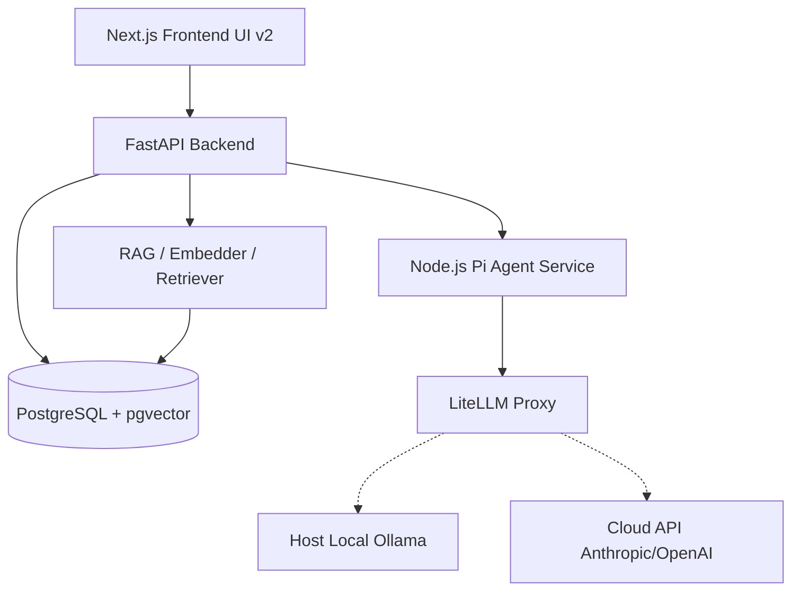

# The Lenny Growth Assistant

The Lenny Growth Assistant is an AI-powered conversational web application that turns Lenny's Podcast transcripts into a reliable internal assistant for product and growth teams. It allows professionals to ask complex questions, get grounded answers with direct source citations, generate highly formatted Ship 30 for 30 essays, and create rendering-safe HTML/CSS artifacts directly in a split-pane viewer—without dealing with prompts or models.

## Features
- **Grounded Q&A Chat:** Conversational RAG over Lenny's Podcast transcripts with clickable citations.
- **Ship 30 for 30 Skill:** Dedicated Pi Coding Agent skill that outputs ~1,250-word, highly formatted essays.
- **Artifact Viewer:** Split-pane rendering of Markdown and HTML/CSS artifacts with secure isolation.
- **LLM Flexibility:** Seamless toggling between Local Ollama and Cloud LLMs (e.g. Anthropic/OpenAI) via configuration.
- **Session Persistence:** Full PostgreSQL persistence of sessions, conversations, and metadata.

## Architecture



## Tech Stack
- **Frontend:** Next.js, React, TailwindCSS
- **Backend:** FastAPI, Python, SQLAlchemy, Alembic
- **Agent Layer:** Official Pi Coding Agent SDK (Node.js)
- **Database:** PostgreSQL with `pgvector`
- **LLM Proxy & Routing:** LiteLLM (via Docker)
- **Local Inference:** Ollama

## Prerequisites
- **Docker** and **Docker Compose** installed.
- **Ollama** installed on your host machine (Windows, macOS, or Linux).

### Ollama Model Installation
Before starting the stack, pull the required local models on your host machine:
```bash
ollama pull llama3.2
ollama pull nomic-embed-text
```

## Evaluator Quick-Start & Fresh Clone Setup

1. **Clone the Repository**
```bash
git clone https://github.com/sanjaim25/lenny-growth-assistant.git
cd lenny-growth-assistant
```

2. **Configure Environment Variables**
```bash
cp .env.example .env
```
The `.env` file contains safe defaults. The `OLLAMA_BASE_URL` is pre-configured to `http://host.docker.internal:11434` to communicate with your host's Ollama instance.

3. **Start the Stack**
```bash
docker compose up --build -d
```
Expected Startup Behavior: This starts the `db` (Postgres), `backend` (FastAPI at 8000), `frontend` (Next.js at 3000), `litellm` (Proxy at 4000), and `agent-service` (Node.js Pi SDK at 3001). Migrations are run automatically.

4. **Ingest Transcripts (One-Time)**
```bash
docker compose exec backend bash -c "mkdir -p data && git clone https://github.com/LennysNewsletter/lennys-newsletterpodcastdata.git data/transcripts || true"
docker compose exec backend python cli_ingest.py
```

5. **Access the App**
Open [http://localhost:3000](http://localhost:3000). The API health is at [http://localhost:8000/api/health](http://localhost:8000/api/health).

## Local vs Cloud Model Configuration
By default, the application uses local `llama3.2` mapped via LiteLLM as `gpt-4o-mini`. This is the **mandatory default and primary demo path**.

To switch to a Cloud Provider (e.g., Groq or Anthropic):
1. Open `.env`.
2. To use Groq (Free Tier):
   - Set `MODEL_ID=groq-llama`
   - Add `GROQ_API_KEY=gsk_your_actual_key`
3. To use Anthropic Claude:
   - Set `MODEL_ID=claude-3-5-sonnet`
   - Add `ANTHROPIC_API_KEY=sk-ant_your_actual_key`
4. Restart backend: `docker compose restart backend agent-service`.

**Verification:** You can verify which provider is active by checking the UI (which responds much faster with cloud models) or inspecting the LiteLLM container logs: `docker compose logs -f litellm` to see where the proxy is routing requests.

**Missing-Key & Rate-Limit Policy:** 
- If cloud keys are missing or invalid, the system gracefully fails or relies on LiteLLM's error handling, propagating clear errors to the UI.
- **Groq Free-Tier:** If you hit rate limits (e.g., 429 Too Many Requests), LiteLLM will report the error. Switch back to local Ollama if limits persist. Ensure `MODEL_ID` strictly matches the fallback local or cloud alias in `litellm_config.yaml`.

## Key Capabilities
- **RAG & Citations:** Ingests markdown chunks. Embeddings are `vector(768)`. Citations returned by LLM are mapped to sources in PostgreSQL and displayed as clickable tags.
- **Essay Skill & HTML Artifacts:** The Node Pi Agent executes skills to generate essays or valid HTML. The UI strictly isolates HTML in a `sandbox=""` iframe using CSP and DOMPurify to prevent XSS.

## Security Model & Limitations
- **HTML Isolation:** All generated HTML is untrusted. Execution is sandboxed.
- **Data Subset:** Demo uses the public Lenny starter pack, not the full archive.
- **Local Model Latency:** Expect 10-15 second response times on `llama3.2` without discrete GPUs.

## Testing & Expected Results
```bash
# Node Pi Agent integration tests
docker compose exec agent-service npm test
# Output should indicate 'Successfully created AgentSession' and 'Smoke test passed'.

# Backend Pytest (Requires python environment)
docker compose exec backend pytest -v
# Validates API, RAG, and health endpoints.
```

## Troubleshooting

| Issue | Resolution |
|-------|------------|
| `connection refused` from Ollama | Ensure Ollama is running on your host. Windows/Mac users: `OLLAMA_BASE_URL=http://host.docker.internal:11434` works out of the box. Linux users may need to add `--add-host host.docker.internal:host-gateway` to compose. |
| Model not found error | Ensure you ran `ollama pull llama3.2` on the host machine. |
| Database connection fails | Allow a few seconds for pgvector to initialize. `docker compose logs db` for details. |
| No citations appear | Ensure you ran the ingestion script: `python cli_ingest.py`. |
| Port conflicts (3000/8000/5432/4000) | Stop any local Postgres or node servers. |

## Project Structure
- `backend/` - FastAPI application, Alembic migrations, database models, ingestion scripts, Pytest.
- `backend/agent_service/` - Node.js Pi Coding Agent integration (`server.mjs`).
- `frontend/` - Next.js UI v2, Tailwind, Artifact Viewer components.
- `agent-logs/` - Real, unfabricated AI development session logs.
- `docker-compose.yml` - Multi-container stack.
- `PRD.md`, `design.md`, `architecture.md`, `IMPLEMENTATION_PLAN.md` - Client handoff documentation.

## Trade-offs and Future Improvements
- **Trade-off:** LiteLLM proxy was chosen to allow the Pi Agent SDK (which expects OpenAI/Anthropic spec) to communicate perfectly with local Ollama, preserving the SDK requirement.
- **Future:** Move to asynchronous streaming for artifact generation, implement a full production vector DB like Pinecone, and add user authentication.

## Evaluator Quick-Start Checklist
- [ ] Docker Compose up
- [ ] Ollama models pulled
- [ ] Ingestion script executed
- [ ] UI accessed at localhost:3000
- [ ] Prompt answered with citations
- [ ] Artifact generated in viewer
